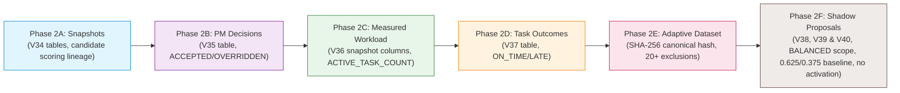
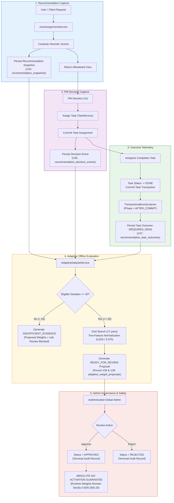
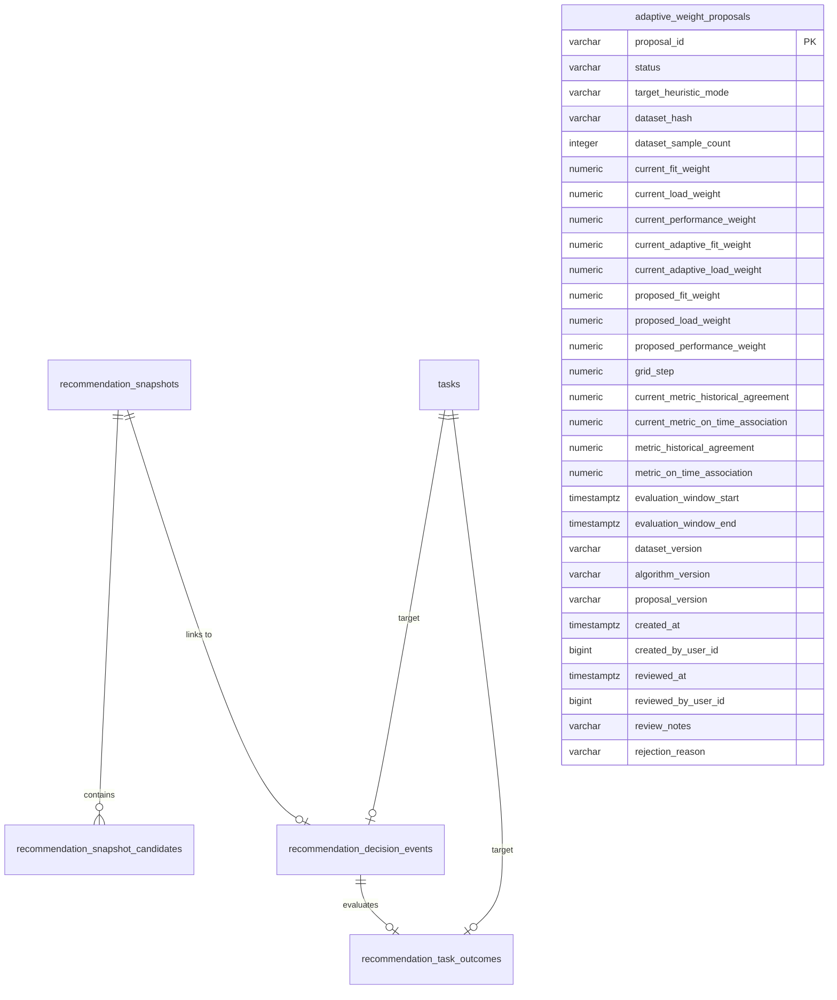
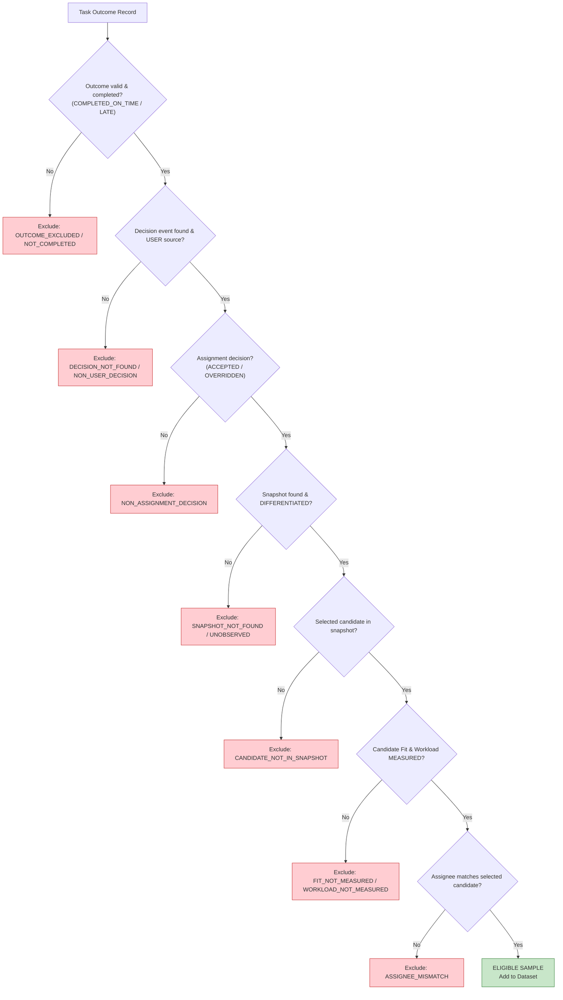
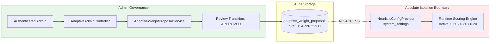
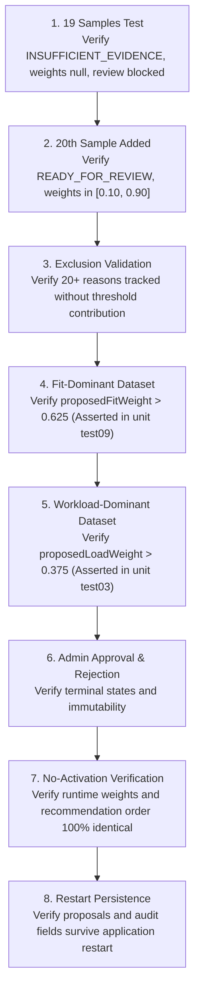

# TaskPilot AI — Phase 2 Adaptive Recommendation Evidence and Shadow Weight Proposal Report

---

- **Subsystem:** `taskpilot-ai` / `taskpilot-app` / `taskpilot-contracts` / `report`
- **Backend Branch:** `fix/heuristic-correctness`
- **Backend Commit Baseline:** `7f2181aa832b8c8aa1ebeb376b43c7f75e85731a`
- **Frontend Branch:** `fix/heuristic-recommendation-contract`
- **Frontend Commit Baseline:** `bf123358e7b8dd63d45bc9e03656f3c0aeb87640`
- **Report Branch:** `main` (`5f5d38f10ab903a12b476d0b2d27858ffdc67acf`)
- **Governing Skill & Decisions:** `taskpilot-heuristic-correctness` / Decisions `H-020` through `H-024`
- **Terminal Implementation Status:** `IMPLEMENTED_AND_AUTOMATED_VERIFIED`
- **Live Local PostgreSQL UAT Status:** `IMPLEMENTED_LIVE_UAT_PENDING`
- **Real Production Dataset Status:** `IMPLEMENTED_REAL_DATA_INSUFFICIENT`
- **Effective Overall Milestone Status:** `PHASE_2_DOCUMENTATION_READY_WITH_UAT_GAPS`

---

## 1. Phase 2 Objective

Phase 2 transitions the TaskPilot candidate recommendation subsystem from an isolated, statically corrected heuristic scoring engine (established in Phase 1) into an **evidence-backed, auditable Adaptive platform**. 

The primary objective is establishing an unbroken, tamper-proof telemetry pipeline:
$$\text{Candidate Recommendation Snapshot} \longrightarrow \text{PM Decision Event} \longrightarrow \text{Task Completion Outcome} \longrightarrow \text{Deterministic Dataset} \longrightarrow \text{Offline Shadow Proposal} \longrightarrow \text{Admin Review}$$

By feeding verified operational outcomes into an offline evaluation model, the system enables data-driven weight optimization while strictly preserving system safety through a **zero-activation guarantee**.

---

## 2. Scope and Non-Goals

### In Scope
1. **Immutable Recommendation Snapshots (Phase 2A)**: Capturing the complete ranking inputs, candidate scores, model version, and heuristic mode at the moment of recommendation.
2. **PM Decision Telemetry (Phase 2B)**: Recording explicit human decisions (`ACCEPTED`, `OVERRIDDEN`) and system events (`EXPIRED`).
3. **Measured Workload Telemetry (Phase 2C)**: Transitioning from unverified global integers to project-scoped counts of active assigned tasks (`ACTIVE_TASK_COUNT`).
4. **Task Completion Outcomes (Phase 2D)**: Automated deadline fulfillment evaluation (`COMPLETED_ON_TIME` vs `COMPLETED_LATE`) triggered post-commit.
5. **Deterministic Dataset Builder (Phase 2E)**: Reconstructing canonical learning datasets with 20+ exclusion gates and SHA-256 integrity verification.
6. **Offline Shadow Proposals & Admin Lifecycle (Phase 2F)**: Bounded grid search optimization across Skill Fit and Workload, two-feature baseline normalization, proposal integrity validation, and an immutable review audit trail.

### Explicit Non-Goals
- **No Online Learning / Dynamic Model Update**: Weights are never updated in streaming or real-time fashion.
- **No Automatic Activation**: Approving a proposal in the Admin console records an audit log but **never** updates active runtime weights or runtime scoring configurations.
- **No Performance-Feature Learning**: Baseline `DEFAULT` performance ($0.50$) is completely excluded from Adaptive space until genuine evaluation cycles exist.
- **No Scheduled Retraining / Automated Rollback**: No background cron jobs or automated rollbacks.
- **No Causal Guarantee**: Historical association is evaluated; no causal guarantee of improved delivery speed is asserted.

---

## 3. Baseline Problems Remediated by Phase 2

Prior to Phase 2, the recommendation engine suffered from fundamental structural gaps that blocked any adaptive capability:

1. **Unverified and Fabricated Workload**:
   - Legacy workload was an administrative scalar entered arbitrarily without timestamps, provenance, or project scoping.
   - *Phase 2 Fix*: Replaced with dynamically measured `ACTIVE_TASK_COUNT` within project boundaries.
2. **Absence of Snapshot Lineage**:
   - Recommendations were transient ephemeral calculations; once rendered, original scores and inputs were lost.
   - *Phase 2 Fix*: Persisted immutable snapshots (`recommendation_snapshots`) with full candidate feature sets.
3. **Missing Human Decision Ground Truth**:
   - The system could not distinguish whether a PM accepted a recommendation, picked another candidate, or assigned tasks outside the AI workflow.
   - *Phase 2 Fix*: Structured decision events (`recommendation_decision_events`) with strict one-terminal-decision constraints.
4. **Lack of Operational Delivery Outcomes**:
   - No historical record existed linking an assignment to actual task completion time versus deadline.
   - *Phase 2 Fix*: Automated post-commit task outcome evaluation (`recommendation_task_outcomes`).
5. **Unsafe Data Interpretation**:
   - Unmeasured metrics were at risk of being treated as failures or zero scores.
   - *Phase 2 Fix*: Explicit status categorization (`MEASURED`, `DEFAULT`, `UNVERIFIED`, `INSUFFICIENT_DATA`) and 20+ dataset exclusion rules.

---

## 4. Phase 2 Roadmap and Delivered Increments



### Detailed Increment Summary

#### Phase 2A: Recommendation Snapshots
- **Flyway Migration**: `V34__create_recommendation_snapshots_tables.sql`.
- **Core Entities**: `RecommendationSnapshotEntity`, `RecommendationSnapshotCandidateEntity`.
- **Contract & Versions**: `presentationContractVersion = "allowlisted-view-v2"`, `scoringModelVersion = "relative-neutral-fixed-point-v2"`.
- **Verification**: 16 automated tests passing in `RecommendationSnapshotTest`.

#### Phase 2B: PM Decision Events
- **Flyway Migration**: `V35__create_recommendation_decision_events_table.sql`.
- **Core Entity**: `RecommendationDecisionEventEntity`.
- **Key Invariants**: Assignment must commit before decision recording. Unique constraint `UNIQUE ("snapshot_id")` ensures at most one decision event per snapshot. Non-recommendation assignments tagged `UNOBSERVED`.
- **Verification**: 33 automated tests passing in `RecommendationDecisionTest`.

#### Phase 2C: Measured Active Task Count Workload
- **Flyway Migration**: `V36__add_phase_2c_measured_workload_to_snapshots.sql`.
- **Architecture**: No separate workload measurements table. Dynamic batch aggregation query `TaskRepository.countActiveAssignedTasksByProject(projectId, terminalStatuses)` (excluding `TaskStatus.DONE`) exposed via `ProjectMemberPort` and implemented by `ProjectModuleAdapter`.
- **Contract & Storage**: DTO `WorkloadMeasurement` (`Math.max(0, value)`, `UNIT_ACTIVE_TASK_COUNT = "ACTIVE_TASK_COUNT"`, `SCOPE_PROJECT = "PROJECT"`, `MetricDataStatus.MEASURED`, timestamped via `workloadMeasuredAt`). Workload columns (`workload_unit`, `workload_scope`, `workload_measured_at`) persisted directly on `recommendation_snapshot_candidates`, supported by index `idx_tasks_project_assignee_status` on `tasks(project_id, assignee_id, status)`.
- **Verification**: 12 unit tests passing in `MeasuredWorkloadActiveTaskCountTest` and 2 adapter tests passing in `ProjectModuleAdapterTest`.

#### Phase 2D: Task Completion Outcomes
- **Flyway Migration**: `V37__create_recommendation_task_outcomes.sql`.
- **Core Entity**: `RecommendationTaskOutcomeEntity`. Adds `completed_at` to `tasks` table with index `idx_tasks_completed_at`.
- **Key Invariants**: `@TransactionalEventListener(phase = AFTER_COMMIT)` triggers isolated `@Transactional(propagation = REQUIRES_NEW)` persistence. Direct instant timestamp comparison ($completedAt \le dueAt$). Unique constraint `CONSTRAINT uk_task_outcomes_decision_task UNIQUE ("decision_id", "task_id")`.
- **Technical Debt**: `TD-P2D-OUTCOME-PERSISTENCE-AFTER-TASK-COMPLETION`, `TD-P2D-REOPEN-HISTORY`.
- **Verification**: 34 automated tests passing in `RecommendationTaskOutcomeTest`.

> **Telemetry Grouping**: Increments 2A through 2D constitute the **Phase 2A–2D Evidence Pipeline**, establishing complete tamper-evident data provenance.

#### Phase 2E: Adaptive Dataset Builder
- **Domain Service**: `AdaptiveDatasetService`.
- **DTOs**: `CandidateFeatureDto`, `AdaptiveDatasetRowDto`, `AdaptiveExclusionReason`, `AdaptiveDatasetQualityReportDto`.
- **Key Invariants**: Canonical sorting by `rowId` ascending, SHA-256 dataset hash, minimum threshold of 20 samples, `dataset_version = "dataset-v1"`. Default performance ($0.50$) completely excluded. Preserves `heuristicMode` on dataset rows; non-`BALANCED` snapshots excluded via `UNSUPPORTED_HEURISTIC_MODE`.
- **Verification**: 24 automated tests passing in `AdaptiveDatasetBuilderTest`.

#### Phase 2F: Offline Adaptive Weight Proposals & Admin Lifecycle
- **Flyway Migrations**: `V38__create_adaptive_weight_proposals.sql`, `V39__correct_adaptive_proposal_safety.sql`, `V40__scope_adaptive_proposals_to_heuristic_mode.sql`.
- **Domain Service & Controller**: `AdaptiveWeightProposalService`, `AdaptiveAdminController` (`/api/v1/admin/ai/adaptive/**`).
- **Key Invariants**: Strategy Pattern integrity via `target_heuristic_mode = "BALANCED"` (nullable in V40 for legacy rows without backfill; legacy rows non-reviewable), two-feature baseline normalization, dynamic runtime baseline loading, 17-point bounded grid search ($[0.10, 0.90]$), 5-level tie-break, proposal integrity gate, `INSUFFICIENT_EVIDENCE` truthful nullability, `algorithm_version = "grid-search-v1"`, `proposal_version = "proposal-v1"`, global Admin authorization, and Absolute No-Activation Guarantee.
- **Verification**: 25 unit tests passing across `AdaptiveWeightProposalTest` (11) and `AdaptiveWeightProposalLifecycleTest` (14), plus 6 synthetic scenario tests in `AdaptiveMvpUatTest` (automated synthetic scenario verification, not live UAT).

---

## 5. System Architecture

### 5.1. End-to-End Evidence and Evaluation Pipeline



### 5.2. Telemetry Entity Relationship Diagram



---

## 6. Data Model and Schema Lineage

The database evolution across Phase 2 is recorded across seven Flyway migrations:

| Migration File | Primary Target Table | Key Schema Changes & Constraints |
| :--- | :--- | :--- |
| `V34__create_recommendation_snapshots_tables.sql` | `recommendation_snapshots`, `recommendation_snapshot_candidates` | Tables for snapshots and candidate scoring inputs; foreign key cascade; check constraints on candidate ranks and weights. |
| `V35__create_recommendation_decision_events_table.sql` | `recommendation_decision_events` | Stores PM decisions (`ACCEPTED`, `OVERRIDDEN`, `REJECTED`, `CANCELED`, `EXPIRED`); unique constraint `UNIQUE ("snapshot_id")` ensures at most one decision per snapshot. |
| `V36__add_phase_2c_measured_workload_to_snapshots.sql` | `recommendation_snapshot_candidates`, `tasks` | Adds `workload_unit`, `workload_scope`, `workload_measured_at` to snapshot candidates; adds index `idx_tasks_project_assignee_status` on `tasks(project_id, assignee_id, status)`. No separate workload measurements table. |
| `V37__create_recommendation_task_outcomes.sql` | `recommendation_task_outcomes`, `tasks.completed_at` | Adds `completed_at` to `tasks` (index `idx_tasks_completed_at`); creates task outcome table with unique constraint `CONSTRAINT uk_task_outcomes_decision_task UNIQUE ("decision_id", "task_id")`. |
| `V38__create_adaptive_weight_proposals.sql` | `adaptive_weight_proposals` | Base table for offline shadow weight proposals and admin review audit fields. |
| `V39__correct_adaptive_proposal_safety.sql` | `adaptive_weight_proposals` | Relaxes NOT NULL on proposed fields for `INSUFFICIENT_EVIDENCE`; adds normalized baseline columns (`current_adaptive_fit_weight`, `current_adaptive_load_weight`), baseline metrics, evaluation windows, versions (`dataset_version`, `algorithm_version`), and backfills historical data. |
| `V40__scope_adaptive_proposals_to_heuristic_mode.sql` | `adaptive_weight_proposals` | Adds `target_heuristic_mode VARCHAR(32) NULL` with check constraint (`IS NULL OR = 'BALANCED'`) and index `idx_adaptive_proposals_target_mode` on `(target_heuristic_mode)`. Preserves legacy proposals without backfill; legacy rows remain non-reviewable. |

---

## 7. Adaptive Dataset Construction and Eligibility

Dataset reconstruction in `AdaptiveDatasetService` enforces strict fail-closed filtering. 



### Canonical Serialization and Hash
Eligible samples are deterministically sorted by `rowId` ascending. A canonical JSON string representation is generated and hashed via SHA-256 (`datasetHash`). Any addition, modification, or reordering of samples alters the digest, providing tamper-evident traceability.

---

## 8. Shadow Proposal Optimization Algorithm

### 8.1. Two-Feature Normalization
Because `performance` is static `DEFAULT` ($0.50$), it is excluded from learning. The active three-criterion weights ($0.50, 0.30, 0.20$) are normalized to two dimensions:
$$\text{currentAdaptiveFit} = \frac{0.50}{0.50 + 0.30} = 0.625$$
$$\text{currentAdaptiveLoad} = \frac{0.30}{0.50 + 0.30} = 0.375$$

### 8.2. Grid Search Space
- Search grid: $w_{fit} \in [0.10, 0.90]$ with `gridStep = 0.05` (17 candidate pairs).
- $w_{load} = 1.0 - w_{fit}$, $w_{perf} = 0.0$.
- Simulated ranking: uses neutral Min-Max normalization and the fixed-point $10^9$ integer comparator with rawFit tie-break (`InternalCandidateRanking.STEP_A_COMPARATOR`).

### 8.3. 5-Level Deterministic Tie-Break
1. **Primary Metric**: `historicalAgreement` (higher ratio of simulated top candidate matching PM choice).
2. **Secondary Metric**: `onTimeAssociation` (higher ratio of simulated top candidate matching PM choice for on-time tasks).
3. **Weight Delta**: Smaller Manhattan distance to normalized baseline:
   $$\Delta = |w_{fit} - 0.625| + |w_{load} - 0.375|$$
4. **Higher Fit Weight**: Preference for higher Skill Fit ($w_{fit}$).
5. **Stable Index**: Lower grid candidate index.

### 8.4. Strategy Pattern and Heuristic Mode Scoping
- **Single-Mode Scope**: In accordance with the project Strategy Pattern (`HeuristicStrategyFactory`), Adaptive proposals in Phase 2 are strictly scoped to the `BALANCED` heuristic mode.
- **Dynamic Configuration Baseline**: The baseline weights are resolved dynamically from the active runtime configuration via `HeuristicStrategyFactory.resolve("BALANCED")` (`system_settings["heuristic.weights"]`), ensuring runtime weight changes are faithfully reflected rather than hardcoded. The baseline $(0.625, 0.375)$ is a synthetic example corresponding to runtime defaults $(0.50, 0.30, 0.20)$; runtime configuration changes (e.g. $0.23 / 0.65 / 0.12$) dynamically yield normalized baseline $\approx 0.26136 / 0.73864$.
- **Fail-Closed Dataset Isolation**: Recommendation snapshots generated under other modes (e.g., `URGENT`, `TRAINING`) or with null mode are excluded by `AdaptiveDatasetService` with exclusion reason `UNSUPPORTED_HEURISTIC_MODE`.
- **Target Mode Persistence & Legacy Safety**: Generated proposals record `target_heuristic_mode = "BALANCED"` in the database (`adaptive_weight_proposals`, Flyway `V40`). V40 adds a nullable column with check constraint (`IS NULL OR = 'BALANCED'`) without synthetic backfill. Legacy proposals retain `null` target mode and remain non-reviewable.
- **Strict Non-Activation**: Review and approval transitions the proposal to `APPROVED` for auditing only, with zero runtime weight mutation.

---

## 9. Security, Governance, and Safety



1. **Role Enforcement**: `/api/v1/admin/ai/adaptive/**` (hoặc `/api/admin/ai/adaptive/**`) requires `ROLE_ADMIN` / `ADMIN`. Non-admin requests receive HTTP 403 Forbidden; unauthenticated receive HTTP 401 Unauthorized.
2. **Actor Resolution**: Reviewer ID is strictly resolved from the authenticated security context email (`UserIdentityPort.findByEmail(...)`). No client-supplied actor ID is trusted.
3. **Proposal Integrity Gate**: Before review, application validation checks: `sampleCount >= 20`, safe bounds $[0.10, 0.90]$, weight sum $1.0$, `targetHeuristicMode == "BALANCED"`, non-blank hash, present metrics, and valid versions. Proposals with unsupported target modes are rejected with HTTP 400 Bad Request.
4. **Terminal State Immutability**: Proposals in `APPROVED` or `REJECTED` reject subsequent review attempts with HTTP 400 Bad Request.
5. **Absolute No-Activation Guarantee**: Approval updates the audit row in `adaptive_weight_proposals`. It **never** mutates `system_settings`, `HeuristicConfigProvider`, active heuristic weights, or runtime recommendation scores.

---

## 10. Verification Results

All test totals reported below are verified directly from the project reactor build outputs:

```
========================================================================================
Verification Suite                                 Discovered  Passed  Failed  Skipped
========================================================================================
Whole Reactor Compilation (7 modules)                      7       7       0        0
Phase 0 Focused Heuristic Tests                           30      30       0        0
  - ScoreRangeTest                                         6       6       0        0
  - HeuristicStrategyTest                                  8       8       0        0
  - HeuristicRankingCharacterizationTest                   6       6       0        0
  - SkillFitSemanticsCharacterizationTest                  8       8       0        0
  - PayloadExposureCharacterizationTest                    2       2       0        0

Phase 2A, 2B, 2D Telemetry Pipeline Suite                 83      83       0        0
  - RecommendationSnapshotTest (Phase 2A)                 16      16       0        0
  - RecommendationDecisionTest (Phase 2B)                 33      33       0        0
  - RecommendationTaskOutcomeTest (Phase 2D)              34      34       0        0

Phase 2C Workload Active Task Count Suite                 14      14       0        0
  - MeasuredWorkloadActiveTaskCountTest                   12      12       0        0
  - ProjectModuleAdapterTest                               2       2       0        0

Phase 2E & 2F Adaptive Test Suite                         55      55       0        0
  - AdaptiveDatasetBuilderTest                            24      24       0        0
  - AdaptiveWeightProposalTest                            11      11       0        0
  - AdaptiveWeightProposalLifecycleTest                   14      14       0        0
  - AdaptiveMvpUatTest (Automated Synthetic Scenarios)     6       6       0        0
========================================================================================
DOCUMENTED FOCUSED CORE SUITES TOTAL (P0+P2AD+P2C+P2EF)   182     182       0        0
========================================================================================
FULL TASKPILOT-AI REGRESSION SUITE                       425     412       0       13
========================================================================================
```

> [!NOTE]
> **Test Accounting Statement**:
> All documented focused suites passed with zero failures and zero errors. These focused-suite totals (182 tests: $30 + 83 + 14 + 55 = 182$) do not represent the complete `taskpilot-ai` regression suite.
> Full taskpilot-ai regression execution produced:
> - **425 discovered**
> - **412 passed**
> - **13 skipped** (integration / infrastructure tests requiring live database or external network)
> - **0 failures**
> - **0 errors**

- **AdaptiveMvpUatTest Role**: Labeled strictly as **automated synthetic scenario verification** (utilizing in-memory mocked repository fixtures to deterministically verify proposal generation, gating, and no-activation semantics). It does NOT constitute live database UAT.
- **Bi-directional Sensitivity Proof**:
  - *Workload-dominant Shift*: `IMPLEMENTED_AND_AUTOMATED_VERIFIED` — `AdaptiveWeightProposalTest.java` `test03` explicitly asserts `proposedLoadWeight > currentAdaptiveLoadWeight` ($0.55 > 0.375$), `proposedFitWeight < currentAdaptiveFitWeight` ($0.45 < 0.625$), `proposedLoadWeight > proposedFitWeight`, unit sum $1.0$, and safe bounds $[0.10, 0.90]$.
  - *Fit-dominant Shift*: `IMPLEMENTED_AND_AUTOMATED_VERIFIED` — `AdaptiveWeightProposalTest.java` `test09` explicitly asserts `proposedFitWeight > currentAdaptiveFitWeight` ($0.75 > 0.625$), `proposedLoadWeight < currentAdaptiveLoadWeight` ($0.25 < 0.375$), `proposedFitWeight > proposedLoadWeight`, unit sum $1.0$, and safe bounds $[0.10, 0.90]$.
  - *Cross-dataset Proof*: `IMPLEMENTED_AND_AUTOMATED_VERIFIED` — `AdaptiveWeightProposalTest.java` `test10` confirms distinct canonical dataset SHA-256 hashes (`assertNotEquals`), distinct proposed weights, and opposing directional shifts relative to normalized baseline $(0.625, 0.375)$.
  - *Dynamic Baseline Normalization*: `IMPLEMENTED_AND_AUTOMATED_VERIFIED` — `AdaptiveWeightProposalTest.java` `test11` confirms that custom runtime weights (e.g. $0.23 / 0.65 / 0.12$) dynamically produce baseline $\approx 0.26136 / 0.73864$ without hardcoded overrides, and invalid denominators block proposal generation.
- **Synthetic Data Limitations**:
  - Synthetic sensitivity tests prove that the implementation responds to controlled evidence.
  - They do not prove: causal improvement, production effectiveness, employee performance, fairness, usefulness on real organizational data, or future model stability.
  - Real evidence accumulation and isolated PostgreSQL UAT remain separate gates.
- **Database Migrations and Schema**:
  - JPA mappings and Flyway V38/V39/V40 migration source are implemented and statically reconciled. V40 adds nullable `target_heuristic_mode` with check constraint without synthetic backfill; legacy proposals remain non-reviewable.
  - Actual migration execution, Hibernate schema validation, proposal persistence, and restart retrieval against isolated PostgreSQL remain NOT YET VERIFIED.
- **Live Local PostgreSQL UAT**: `IMPLEMENTED_LIVE_UAT_PENDING` (Local daemon port 5432 closed; remote Supabase connection prohibited).

---

## 11. Current Project Status

```text
Adaptive Implementation:       IMPLEMENTED
Automated Test Verification:   PASSED (182 documented focused suite tests; full taskpilot-ai regression: 425 discovered, 412 passed, 13 skipped, 0 failures, 0 errors)
Database Migrations (V34-V40): IMPLEMENTED AND STATICALLY RECONCILED; LIVE EXECUTION NOT YET VERIFIED
Directional Sensitivity Proof: BI-DIRECTIONAL SENSITIVITY PROVEN VIA SYNTHETIC AUTOMATION (Fit 0.75 > 0.625, Load 0.55 > 0.375)
Isolated Local PostgreSQL UAT: PENDING (Daemon closed on port 5432)
Restart Persistence:           IMPLEMENTED VIA JPA MAPPING AND STATICALLY RECONCILED; LIVE EXECUTION NOT YET VERIFIED
Real Production Dataset:       INSUFFICIENT (< 20 operational samples accumulated)
Runtime Weight Activation:     NOT IMPLEMENTED BY DESIGN (Zero-Activation Guarantee)
Milestone Completion Status:   PHASE_2_DOCUMENTATION_READY_WITH_UAT_GAPS
```

---

## 12. Risks and Technical Debt

1. **`TD-P2D-OUTCOME-PERSISTENCE-AFTER-TASK-COMPLETION`**:
   - *Risk*: If secondary telemetry persistence fails after task completion commits, the outcome record is missing.
   - *Mitigation*: Task completion takes precedence; failure is logged. Dataset builder safely excludes missing outcomes.
   - *Exit Condition*: Implement Transactional Outbox pattern in a future infrastructure phase.
2. **`TD-P2D-REOPEN-HISTORY`**:
   - *Risk*: Tasks reopened from `DONE` preserve the original outcome record to reflect initial commitment fulfillment. Re-completion does not overwrite the record.
   - *Mitigation*: Support multi-cycle rework lifecycle versioning if required.
3. **Pending Action Durability**:
   - *Risk*: AI tool pending actions reside in-memory; server restarts clear pending confirmations.
   - *Exit Condition*: Persist pending actions in a relational store if long-lived approvals are required.

---

## 13. How Adaptive Will Be Demonstrated

The complete verification sequence to demonstrate Adaptive MVP:



---

## 14. Lessons Learned

1. **Telemetry Precedes Learning**: Establishing tamper-proof, versioned data capture (Snapshots, Decisions, Outcomes) is essential before any optimization logic can be attempted.
2. **Missing Data Must Remain Unknown**: Unmeasured metrics must never be coerced into zero or default penalties, as this introduces severe bias into learning models.
3. **Separation of Evaluation and Activation**: Decoupling offline shadow evaluation from runtime execution protects production stability while allowing stakeholders to audit model recommendations.
4. **Strict Isolation Protects Integrity**: Prohibiting manual SQL mutations during UAT ensures that every data point satisfies full business constraints.

---

## 15. Conclusion and Next Steps

The Adaptive MVP foundation and offline shadow proposal architecture are fully implemented, statically reconciled, and verified by 182 documented focused core automated tests (passing with 0 failures and 0 errors) and full taskpilot-ai regression (425 discovered, 412 passed, 13 skipped, 0 failures, 0 errors). The system demonstrates mathematically sound baseline normalization, truthful nullability, fail-closed proposal integrity, automated bi-directional synthetic sensitivity proofs, and an absolute no-activation boundary.

Current documented milestone status: `PHASE_2_DOCUMENTATION_READY_WITH_UAT_GAPS`.

### Remaining Steps to Close Milestone
1. Start an isolated PostgreSQL daemon on `localhost:5432`.
2. Execute the procedural runbook (`ADAPTIVE_MVP_VERIFICATION_RUNBOOK.md`) across Scenarios A through I.
3. Verify restart persistence against the local database.
4. Update final status to `ADAPTIVE_MVP_COMPLETE`.
